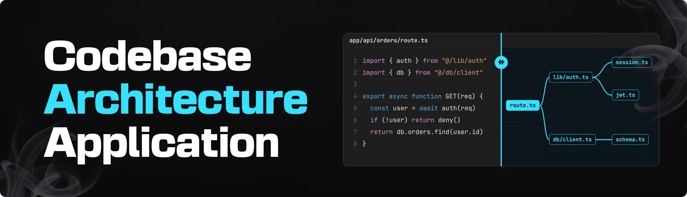
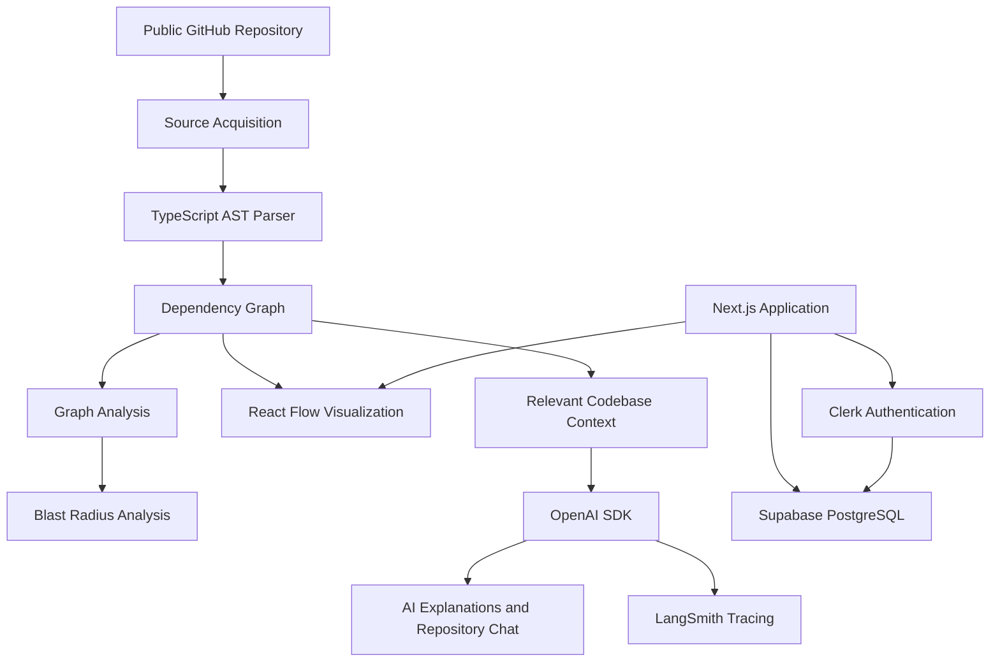

 <div align="center">

  <!-- Portfolio: UPDATE_WITH_YOUR_PORTFOLIO_URL -->

  <a href="https://github.com/MrinmoyNandi" target="_blank">
    
  </a>

  <br />

  
  
  
  <br />
  
  
  
  

  <h1>Code Crafter</h1>

  <h3>AI-Powered Codebase Dependency Mapper</h3>

  <p>
    Understand your codebase. Visualize dependencies. Make smarter changes.
  </p>

  <p>
    Developed by <a href="https://github.com/MrinmoyNandi">Mrinmoy Nandi</a>
  </p>

  <!-- Portfolio: Replace UPDATE_WITH_YOUR_PORTFOLIO_URL with your actual portfolio URL -->
  <p>
    <a href="UPDATE_WITH_YOUR_PORTFOLIO_URL">Portfolio</a>
    ·
    <a href="https://github.com/MrinmoyNandi">GitHub Profile</a>
  </p>

</div>

---

## 📋 Table of Contents

1. [Introduction](#-introduction)
2. [Problem Statement](#-problem-statement)
3. [Tech Stack](#️-tech-stack)
4. [Features](#-features)
5. [How It Works](#-how-it-works)
6. [Architecture Principles](#-architecture-principles)
7. [Getting Started](#-getting-started)
8. [Environment Variables](#-environment-variables)
9. [Running the Project](#-running-the-project)
10. [Project Structure](#-project-structure)
11. [Security](#-security)
12. [Future Improvements](#-future-improvements)
13. [Author](#-author)
14. [License](#-license)

## ✨ Introduction

**Code Crafter** is an AI-powered developer tool designed to transform public JavaScript and TypeScript repositories into interactive dependency maps.

Modern codebases can become difficult to understand as projects grow, modules multiply, and dependencies become increasingly interconnected. This challenge becomes even more significant when developers work with AI-generated code that they haven't fully explored.

Code Crafter addresses this problem by combining deterministic Abstract Syntax Tree (AST) analysis with interactive graph visualization and AI-powered explanations.

Instead of relying on AI to guess how a codebase works, Code Crafter extracts actual dependency relationships from source code and uses that verified information to help developers understand their projects.

### 🎯 Core Objective

Build a reliable environment where developers can:

- Explore the internal structure of unfamiliar repositories.
- Understand how files and modules depend on one another.
- Identify the potential impact of modifying a file.
- Receive contextual explanations of complex modules.
- Ask architectural questions and explore verified dependency paths.
- Collaborate with other developers through shared organization workspaces.

**The fundamental principle:** code analysis determines the structure; AI helps explain it.

## 🧩 Problem Statement

Understanding an unfamiliar codebase often requires manually inspecting dozens or hundreds of files.

This becomes challenging when:

- Imports and dependencies are spread across multiple directories.
- A single module is connected to many other modules.
- Changes introduce unexpected side effects.
- AI-generated implementations contain unfamiliar architectural patterns.
- Developers struggle to trace the flow of dependencies through an application.

Traditional code editors provide navigation and search, but they don't always offer a unified, visual representation of the architecture.

Code Crafter aims to bridge this gap with a searchable, interactive dependency graph backed by actual source-code analysis.

## ⚙️ Tech Stack

| Technology | Purpose |
|---|---|
| [Next.js 16](https://nextjs.org/) | Full-stack framework, App Router, server rendering and server-side application logic |
| [TypeScript 5](https://www.typescriptlang.org/) | Type safety across application logic and the parsing pipeline |
| [ts-morph](https://ts-morph.com/) | AST analysis and extraction of imports, exports and dependency relationships |
| [React Flow](https://reactflow.dev/) (`@xyflow/react`) | Interactive graph rendering, node selection and dependency navigation |
| [dagre](https://github.com/dagrejs/dagre) | Automatic graph layout |
| [Clerk](https://clerk.com/) | Authentication, identity management and organization support |
| [Supabase](https://supabase.com/) | PostgreSQL database, persistent storage and Row-Level Security |
| [OpenAI SDK](https://platform.openai.com/) | AI-powered code explanations and repository question answering |
| [LangSmith](https://smith.langchain.com/) | LLM tracing, observability and evaluation |
| [Tailwind CSS v4](https://tailwindcss.com/) | Utility-first styling and responsive UI development |
| [CodeRabbit](https://www.coderabbit.ai/) | AI-assisted code reviews and development feedback |
| [pnpm](https://pnpm.io/) | Package management and development workflows |

## 🔋 Features

### 1. AST-Based Codebase Parsing

Analyze JavaScript and TypeScript repositories using source-code parsing rather than AI-generated guesses.

- Extract static imports and exports.
- Identify re-exports and supported dynamic imports.
- Detect supported CommonJS `require()` calls.
- Build a graph of files and their dependency relationships.
- Represent the analyzed repository as structured nodes and edges.

### 2. Interactive Dependency Visualization

Explore your codebase through an interactive graph.

- Zoom and pan across the canvas.
- Select individual files and modules.
- Expand folders to inspect individual files.
- Navigate incoming and outgoing dependencies.
- Explore relationships between connected modules.

### 3. Blast Radius Analysis

Understand the potential impact of changing a particular file.

- Identify modules that directly depend on a selected file.
- Explore downstream dependency relationships.
- Inspect dependency chains before making changes.
- Use graph traversal to calculate potential impact.

Blast radius results describe structural dependency relationships; they do not guarantee that every affected runtime behavior has been identified.

### 4. AI-Powered Module Explanations

Generate contextual explanations using information extracted from the codebase.

- Understand the responsibility of a module.
- Review its dependencies and relationships.
- Navigate referenced files from explanations.
- Use verified graph information as context for AI responses.

### 5. Repository Architecture Chat

Ask questions about the structure of an analyzed repository.

Example questions:

- How are the main modules connected?
- Which files depend on this service?
- What is the dependency path between two modules?
- Which modules might be affected if this file changes?
- Explain the responsibilities of this directory.

The AI layer should distinguish verified relationships from inferences and avoid presenting unsupported relationships as facts.

### 6. Multi-Tenant Collaboration

Enable teams to work with shared repository analyses.

- Authenticate users with Clerk.
- Associate shared analyses with organizations.
- Apply authorization checks to organization-scoped resources.
- Store persistent data in Supabase.
- Enforce appropriate database access policies.

### 7. Database-Level Security

Use PostgreSQL Row-Level Security to protect organization data.

- Restrict access to authorized records.
- Apply policies based on validated user and organization claims.
- Keep server-side secrets out of client-side code.
- Enforce authorization in addition to authentication.

### 8. AI Observability and Evaluation

Use LangSmith to inspect and evaluate AI-powered workflows.

- Trace model calls.
- Investigate latency and execution failures.
- Review model inputs and outputs.
- Evaluate response quality against suitable test cases.
- Monitor whether explanations remain consistent with the analyzed repository.

## 🔄 How It Works

At a high level, Code Crafter follows this workflow:

1. **Repository input:** A user provides a supported public GitHub repository.
2. **Source acquisition:** The application obtains the repository's supported source files.
3. **AST analysis:** `ts-morph` parses the source code and extracts dependency relationships.
4. **Graph construction:** The parser produces structured file nodes and dependency edges.
5. **Graph visualization:** React Flow renders the graph, with dagre helping arrange its layout.
6. **Dependency exploration:** Users inspect modules, traverse relationships and calculate potential blast radius.
7. **AI assistance:** The application supplies relevant, verified codebase context to the AI layer.
8. **Observability:** LangSmith supports tracing and evaluation of AI workflows.



The diagram represents the intended logical architecture; exact runtime boundaries depend on the implementation.

## 🏗️ Architecture Principles

Code Crafter follows several important engineering principles.

**Deterministic analysis**

Dependency relationships should originate from source-code analysis rather than AI predictions.

**Separation of concerns**

Parsing, graph analysis, visualization, persistence and AI reasoning should remain distinct responsibilities.

**Grounded AI**

AI explanations should use available source-code and graph context, communicate uncertainty and avoid inventing repository files or connections.

**Security by design**

Authentication, organization membership, server-side authorization and database policies should work together to protect resources.

**Observable AI workflows**

Tracing and evaluation should help identify errors, regressions and unsupported claims.

## 🚀 Getting Started

Follow these instructions to set up Code Crafter locally.

### Prerequisites

Ensure that you have the following installed:

- [Git](https://git-scm.com/)
- [Node.js](https://nodejs.org/) — use a version compatible with the project dependencies.
- [pnpm](https://pnpm.io/)
- Accounts and credentials for the external services you intend to use.

### 1. Clone the Repository

```bash
git clone https://github.com/MrinmoyNandi/code-crafter.git
cd code-crafter
```

> Replace the repository URL if your GitHub repository uses a different name or location.

### 2. Install Dependencies

```bash
pnpm install
```

### 3. Configure Environment Variables

Create a `.env.local` file in the project root.

Add the environment variables documented below, then fill in the credentials from your own service dashboards.

### 4. Start the Development Server

```bash
pnpm dev
```

Open [http://localhost:3000](http://localhost:3000) in your browser.

> If the AI agent runs as a separate service in your repository, start that service in its own terminal using its documented commands.

## 🔐 Environment Variables

The following is a template based on the intended integrations. Exact variable names must match the code in your repository.

```env
# Clerk Authentication
NEXT_PUBLIC_CLERK_SIGN_IN_URL=/sign-in
NEXT_PUBLIC_CLERK_SIGN_UP_URL=/sign-up
NEXT_PUBLIC_CLERK_SIGN_IN_FALLBACK_REDIRECT_URL=/
NEXT_PUBLIC_CLERK_SIGN_UP_FALLBACK_REDIRECT_URL=/
NEXT_PUBLIC_CLERK_PUBLISHABLE_KEY=
CLERK_SECRET_KEY=

# Supabase
NEXT_PUBLIC_SUPABASE_URL=
NEXT_PUBLIC_SUPABASE_PUBLISHABLE_KEY=
SUPABASE_SECRET_KEY=

# OpenAI
OPENAI_API_KEY=

# LangSmith
LANGSMITH_TRACING=true
LANGSMITH_API_KEY=
LANGSMITH_PROJECT=code-crafter
LANGSMITH_ENDPOINT=https://api.smith.langchain.com

# Agent Service
AGENT_URL=http://localhost:2024
```

### Where to Obtain Credentials

- **Clerk:** [clerk.com](https://clerk.com/)
- **Supabase:** [supabase.com](https://supabase.com/)
- **OpenAI:** [platform.openai.com](https://platform.openai.com/)
- **LangSmith:** [smith.langchain.com](https://smith.langchain.com/)

**Important security notes:**

- Never commit `.env.local` or real API keys to GitHub.
- Keep secret keys on the server.
- Use only public/publishable keys in browser-accessible variables.
- Configure Supabase Row-Level Security and verify that authorization policies match your application's actual identity claims.
- Do not expose a Supabase secret/service-role key to the client.
- Add all required variables to your deployment environment before deploying.

## 📁 Project Structure

The exact structure depends on the repository implementation. A typical organization for this stack could look like:

```text
code-crafter/
├── app/                    # Next.js routes and application pages
├── components/             # Reusable UI components
├── lib/                    # Shared utilities and service integrations
├── services/               # Application and domain services
├── parser/                 # AST parsing and dependency extraction
├── graph/                  # Graph construction and analysis
├── deep-agent/             # Optional separate AI agent service
├── supabase/               # Database schema and security policies
├── public/
│   └── readme/              # README images and visual assets
├── tests/                  # Automated tests
├── .env.local               # Local environment variables (not committed)
├── .gitignore
├── package.json
├── pnpm-lock.yaml
├── tsconfig.json
└── README.md
```

This is an illustrative structure, not a claim about the directories currently present in your repository.

## 🛡️ Security

Security is an essential part of a tool that analyzes external repositories and supports shared workspaces.

The implementation should account for:

- Organization-level access control.
- Server-side validation of user permissions.
- Proper Supabase RLS configuration.
- Safe handling of external repository input.
- API key and secret management.
- Rate limiting and resource limits for repository analysis.
- Safe treatment of repository source code and AI prompts as untrusted input.
- Appropriate handling of private data in logs and LLM traces.

Repository parsing should be isolated from unsafe execution. Parsing external source code should not require executing that code.

## 🗺️ Future Improvements

Potential directions for future development include:

- [ ] Support for additional languages and module systems.
- [ ] Incremental graph updates when files change.
- [ ] Advanced circular dependency detection.
- [ ] Search and filtering across large dependency graphs.
- [ ] Export dependency graphs in common formats.
- [ ] GitHub integration for repository updates.
- [ ] Pull request impact analysis.
- [ ] Improved graph performance for large repositories.
- [ ] More comprehensive parser and graph-analysis test suites.
- [ ] AI evaluation datasets for architecture questions.
- [ ] Enhanced team collaboration and shared analysis history.

These are possible improvements, not claims that the features are already implemented.

## 👨‍💻 Author

**Mrinmoy Nandi**

Computer Science and Engineering student interested in software engineering, backend development, AI/ML and building developer-focused tools.

- **GitHub:** [MrinmoyNandi](https://github.com/MrinmoyNandi)
- **Portfolio:** `<!-- UPDATE_WITH_YOUR_PORTFOLIO_URL -->`

<!-- Add your portfolio link above when your website is ready. -->

## 📄 License

Choose and add a license that matches how you want this repository to be used.

If you intend to make the project open source, consider adding a `LICENSE` file to the repository and linking to it here.

---

<div align="center">

  **Code Crafter — Understand the connections behind your code.**

  Built with curiosity by **Mrinmoy Nandi**.

</div>

